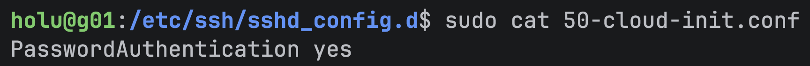

# Solution

## Cloud-init configuration

To create the configuration, follow the instructions laid out in [Hetzner - Basic Cloud Config](https://community.hetzner.com/tutorials/basic-cloud-config/).
The page provides the full configuration necessary to create the basic server instance via _cloud-init_.

_Cloud-init_ generates its own config file _50-cloud-init.conf_ automatically, which enables password login by default:



To ensure the desired SSH configuration takes effect, an additional parameter has to be added to prevent password login from being enabled:
```terraform
ssh_pwauth: false
```

### Verifying the configuration

To verify the configuration was created correctly, run the schema validation:


## Server creation

To create the server, log into the [Hetzner Console](https://console.hetzner.com/projects), select a project, and navigate to the `Servers` tab in the sidebar.

There a server can be bought and created manually. Paste the _cloud-init_ configuration in the `Cloud config` text box and buy the server.

> **Note:**<br> 
> No SSH keys were provided manually, since the configuration will add them to `authorized_keys` automatically.

<br>

