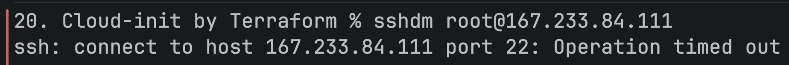
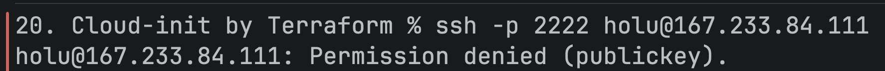
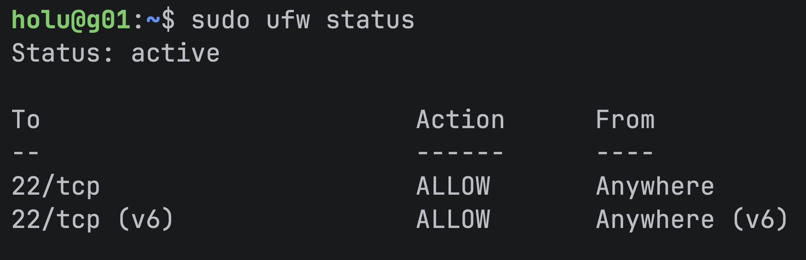
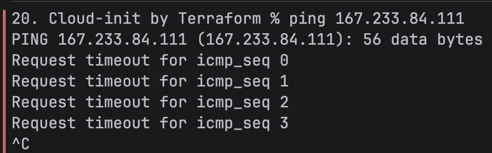
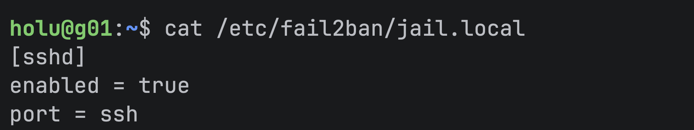

# Results

## Logging into the server

After waiting for the script to run, log into the newly created server.
Since we changed the port SSH runs on, we have to specify `-p 2222`:

``` bash
ssh -i ~/.ssh/hdm -p 2222 holu@167.233.84.111
```

Note that a login as user `root` is no longer possible:



Logging in has to be done as the user `holu`:


Attempting a login without a permitted public key fails without allowing password login:



Logging in was successful, confirming the _cloud-init_ configuration was loaded.
The specified SSH keys were placed into the server's `authorized_keys` file:


## Firewall

The configuration was supposed to set up a simple firewall, allowing only incoming SSH traffic to establish a connection.




The firewall created via _cloud-init_ drops all packets except SSH traffic.
ICMP is usually enabled by default if a server is created via the Hetzner GUI, but pinging the server for example doesn't work anymore since the firewall rules don't allow them through:



## Fail2Ban

In addition, _fail2ban_ was set up.<br>
Repeated failed attempts are already penalized by the system, meaning _fail2ban_ doesn't register the unsuccessful tries: 


It is possible to confirm the tool was still set up by checking the file `jail.local`:


