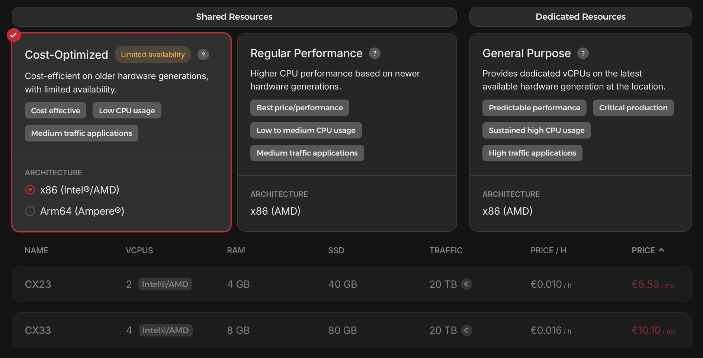
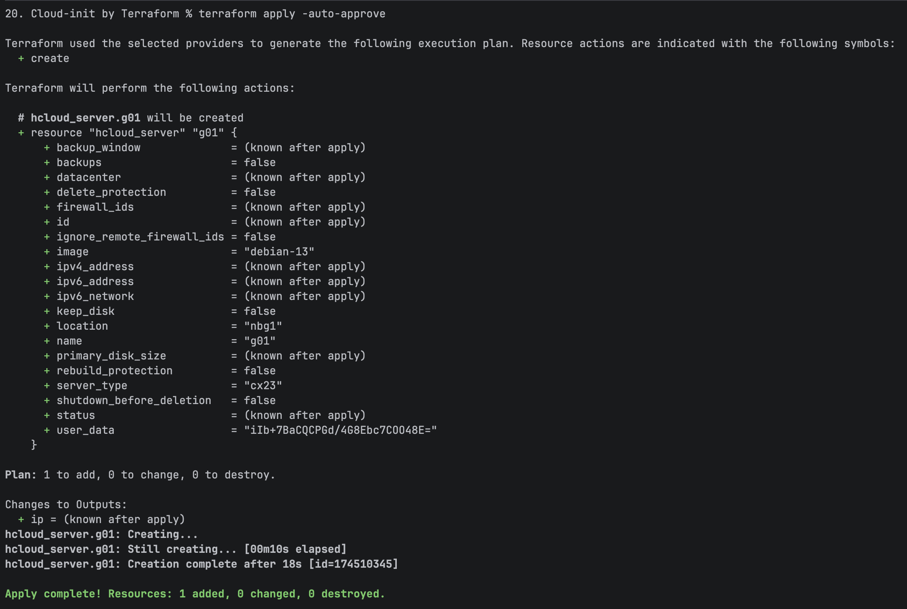

# Result

The resulting server configuration was the same as described in [Exercise 19. Results](../19.%20Cloud-init%20for%20starters/2.%20Result%20Verification.md), except for the following:

- A cheaper server type was selectable via the API, meaning the server ran on a machine with fewer resources.

Terraform allows creation of the server type `Cost-Optimized CX23`:
```terraform
variable "serverType" {
  description = "Server type"
  type = string
  nullable = true
  default = "cx23"
}
```

Servers of type `CX23` are only available in limited amounts and sometimes not selectable via the GUI:



- The deployment was now possible via Terraform, meaning the need for manual GUI interaction was gone.

This means the deployment can be done via shell and therefore automated:

