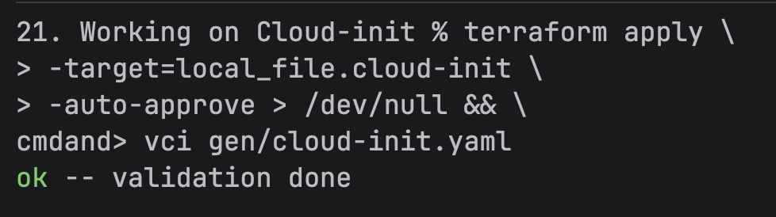

# Solution

## Setup (_setup.tf_)

The project was created via the _init.sh_ script, which created the base directory and the _setup.tf_ file:
Assume this script was run to create the following exercises. 
If anything was altered or omitted, the setup section of that exercise's solution page will specify which steps were taken.

### Providers

This file contains the base components used across many exercises, such as the required providers:
```terraform
terraform {
  required_providers {
    hcloud = ...
    local = {
      source = "hashicorp/local"
    }
  }
  required_version = ">= 1.5"
}
```
In addition to the `hcloud` provider (see [Ex. 19. Cloud-init for starters/1. Solution](../20.%20Cloud-init%20by%20Terraform/1.%20Solution.md#cloud-provider)), the provider for local file interfacing is necessary:

**local**: <br>
The `local` provider by Hashicorp enables use of functions that operate on the local file system.<br>
To lean more, visit:<br>
- [Terraform Registry - Hashicorp Local Provider](https://registry.terraform.io/providers/hashicorp/local/latest/docs)

### Api Token

The API token was created in the same manner as it was in [Ex. 19. Cloud-init for starters/1. Solution](../20.%20Cloud-init%20by%20Terraform/1.%20Solution.md#hetzner-cloud-api-token).

### SSH Keys

The SSH keys allowed to access the server were imported via `setup.tf.template`:

```terraform
# Load the common configuration
module "config" {
  source = "../Modules/Conf"
}

# Set up SSH keys
resource "hcloud_ssh_key" "sshKeys" {
  for_each   = module.config.authorizedKeys
  name       = each.key
  public_key = each.value
}
```

To learn more, visit:<br>
- [Terraform Registry - hcloud_ssh_keys Resource](https://registry.terraform.io/providers/hetznercloud/hcloud/latest/docs/resources/ssh_key)

## Templates

### index.html
The _index.html_ template from the [exercise description]() was copied into the directory `21. Enhancing index.html generation/templates`.
It contains the following interpolation sequences for which values will be provided later:
```html
- ${creationDate}
- ${serverName}
- ${ipv4Address}
- ${ipv6Address}
- ${ipv6Subnet}
```

These sequences will be replaced by the `templatefile` function.

To learn more, visit:<br>
- [Hashicorp - templatefile function](https://developer.hashicorp.com/terraform/language/functions/templatefile)

### cloud-init.yaml
The _cloud-init.yaml_ template was created in the directory `21. Enhancing index.html generation/templates`.
The configuration was written in [HCL](https://github.com/hashicorp/hcl) (_HashiCorp Configuration Language_) beforehand and then wrapped in a call to `${yamlencode()`.
This was done to prevent indentation problems which can occur during string interpolation.
To learn more, visit:
- [HashiCorp - yamlencode](https://developer.hashicorp.com/terraform/language/functions/yamlencode)
- [HashiCorp - Terraform language types and values](https://developer.hashicorp.com/terraform/language/expressions/types)

To enable our webserver to access the dynamically generated _index.html_ file, we need to copy it into the `/var/www/html` directory.
We also set permission so the file can be read by the reverse proxy we will use to serve the content (`nginx`).
```hcl
write_files = [
  {
    content     = "${html}"
    path        = "/var/www/html/index.html"
    permissions = "0644"
    owner       = "root:root"
  }
]
```

To learn more, visit:<br>
- [Cloud-init - Write files](https://docs.cloud-init.io/en/26.1/reference/modules.html#mod-cc-write-files)
- [Linux Foundation - File permissions](https://www.linuxfoundation.org/blog/blog/classic-sysadmin-understanding-linux-file-permissions)

All that was left to do is write the instructions for the webserver to be installed and run:
```hcl
packages = ["nginx"]
runcmd = [
    "systemctl enable nginx",
    "systemctl start nginx"
  ]
```

## Terraform

### Network configuration
The webpage is supposed to display the webserver's IP addresses, which requires us to create a resource for each IP type:

```terraform
resource "hcloud_primary_ip" "ipv4" {
  name        = "primary-ipv4"
  location    = module.server.serverLocation
  type        = "ipv4"
  auto_delete = true
}

resource "hcloud_primary_ip" "ipv6" {
  name        = "primary-ipv6"
  location    = module.server.serverLocation
  type        = "ipv6"
  auto_delete = true
}
```

It is important to provide both resources with the same `location`, since the IPs need to be located in the same datacenter for the server creation to work.
We set `auto_delete` to `true`. The IP addresses will be deleted by Hetzner once the servers no longer exist (i.e. you call `terraform destroy`).

To learn more, visit:<br>
- [Terraform registry - hcloud_primary_ip](https://registry.terraform.io/providers/hetznercloud/hcloud/latest/docs/resources/primary_ip)

### Firewall
To allow web traffic, we need to allow inbound HTTP traffic. 
Additionally, set up SSH access and whitelist ICMP packets for easier server access and simpler monitoring.   
Add the names ```"ssh", "icmp", "http"``` to the list of common firewall rules inside the firewall resource created by the `init.sh` script:
```terraform
for name in ["ssh", "icmp", "http"] : name => module.firewall.firewall_rules[name]
```

### Template Processing

#### index.html

To create the static webpage `nginx` should serve under the server's IP the file needs to generated by interpolating the strings listed in [Templates - index.html](#indexhtml)
This can be achieved via the previously mentioned `templatefile` function.
It can replace content in a local file and save the generated output.

The function takes as many arguments as should be replaced as a key-value pair.
It matches the provided keys against strings to be interpolated and replaces them with the associated value.
We need to pass the attributes of the previously created IP resources to this function to replace the placeholders in the template.
This needs to happen after resource creation of the IPs, since the ouput will be a static _html_ file which requires the values to be hard-coded in.

```terraform
resource "local_file" "index" {
  content = templatefile("templates/index.html", {
    creationDate = timestamp()
    serverName   = module.server.serverName_g01
    ipv4Address  = hcloud_primary_ip.ipv4.ip_address
    ipv6Address  = hcloud_primary_ip.ipv6.ip_address
    ipv6Subnet   = hcloud_primary_ip.ipv6.ip_network
  })
  filename = "gen/index.html"
}
```

The generated output will be saved to `gen/index.htlm`:

```html
<!DOCTYPE html>
<html lang="en">
<head>
    <title>Template demo</title>
</head>
<body>
<h1>Terraform template file demo created 2026-11-10T12:10:43Z.</h1>
<p>This is server <b>g01</b> with IP addresses:</p>
<ul>
    <li>IPV4: <a href="http://2.31.146.28">2.31.146.28</a></li>
    <li>IPV6: <a href="http://[2a01:4f8:1c1c:bbd6::]">2a01:4f8:1c1c:bbd6::</a> from subnet 2a01:4f8:1c1c:bbd6::/64</li>
</ul>
</body>
</html>
```

#### cloud-init.yaml

The generated _html_ file can now be passed into our _cloud-init_ config.
We need to provide the parameter `html` with the previously generated file accessible via `local_file` to interpolate `"${html}"`.

```terraform
resource "local_file" "cloud-init" {
  content = templatefile("templates/cloud-init.yaml", {
    html = local_file.index.content
  })
  filename = "gen/cloud-init.yaml"
}
```

The generated output will be saved to `gen/cloud-init.yaml`:

```html
#cloud-config

"packages":
- "nginx"
"runcmd":
- "systemctl enable nginx"
- "systemctl start nginx"
"write_files":
- "content": |-
    <!DOCTYPE html>
    <html lang="en">
    <head>
        <title>Template demo</title>
    </head>
    <body>
    <h1>Terraform template file demo created 2026-11-10T12:10:43Z.</h1>
    <p>This is server <b>g01</b> with IP addresses:</p>
    <ul>
        <li>IPV4: <a href="http://2.31.146.28">2.31.146.28</a></li>
        <li>IPV6: <a href="http://[2a01:4f8:1c1c:bbd6::]">2a01:4f8:1c1c:bbd6::</a> from subnet 2a01:4f8:1c1c:bbd6::/64</li>
    </ul>
    </body>
    </html>
  "owner": "root:root"
  "path": "/var/www/html/index.html"
  "permissions": "0644"

```

#### Verifying the output
To verify the generated _cloud-init.yaml_ file, we can target the local file creation explicitly without creating the server resource.
Supply the option `-target=local_file.cloud-init` when running `terraform apply`.
This will only execute the resource creation of the _cloud-init_ file, as well as all other operations it depends on:



This confirms the file is correctly encoded.

**Note:**
> This already creates the IPs on Hetzner's end, since the _cloud-init_ creation depends on the _index.html_ creation, which in turn depends on the IP address resources.
> Run `terraform destroy` after this step!

## Server Creation

To use the common server parameters, load the server module:
```terraform
module "server" {
  source = "../Modules/Server"
}
```

We then instantiate the server resource with the common parameters and resources, as well as the IP addresses and _cloud-init_ configuration we created in the previous steps.
```terraform
resource "hcloud_server" "g01" {
  name         = module.server.serverName_g01
  image        = module.server.serverImage
  server_type  = module.server.serverType
  location     = module.server.serverLocation
  ssh_keys     = [for key in hcloud_ssh_key.sshKeys : key.id]
  firewall_ids = [hcloud_firewall.nginx.id]

  public_net {
    ipv4 = hcloud_primary_ip.ipv4.id
    ipv6 = hcloud_primary_ip.ipv6.id
  }

  user_data = local_file.cloud-init.content
}
```

To learn more, visit:<br>
- [Terraform Registry - hcloud_server Primary IPs](https://registry.terraform.io/providers/hetznercloud/hcloud/latest/docs/resources/server.html#primary-ips)

**Note:**
> The combination of the default server type `cx23` and the default location `nbg1` might not be available.
> If this occurs, you can try another location (e.g. `fsn1`). Keep in mind, the location declared in the IP resources must be changed accordingly!