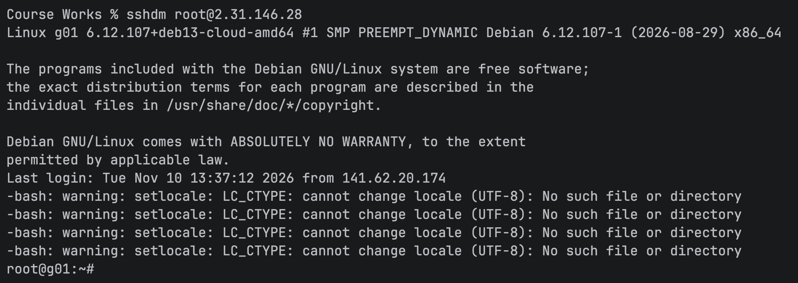
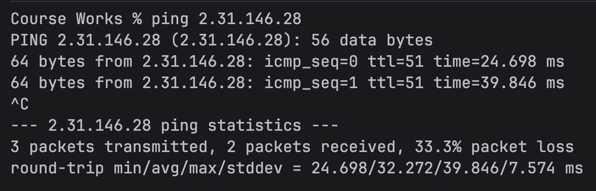
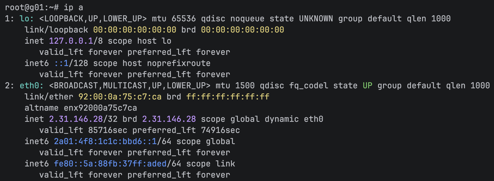
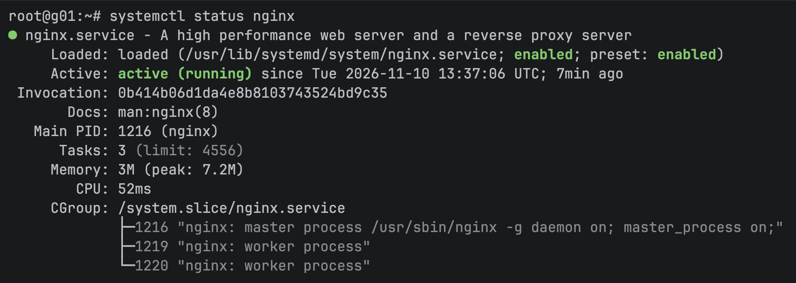
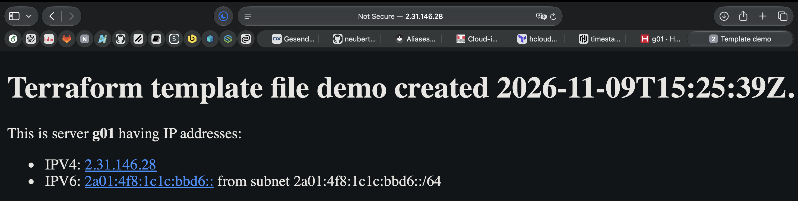

# Result

## Firewall

### SSH

Logging in as root via SSH was possible as intended:

### ICMP

Pinging the server was possible as well:

### HTTP

Accessing the webserver was possible via HTTP, meaning a TCP connection on port 80 was able to be established as intended. 
See [Result - Web Server](#static-webpage-_indexhtml_)

## Server

### IP addresses

The server was assigned two IP addresses:

These can be used to confirm the validity of our generated _index.html_ landing page in the following section.

## Web-Server

### nginx

The `nginx` package was installed and the service was run by the _cloud-init_ configuration:

### Static webpage (_index.html_)

The webpage was accessible via HTTP through the browser.
It contained the correct data, which means the interpolated file was served as intended:

