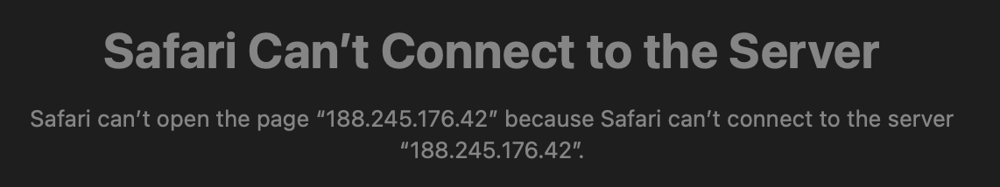
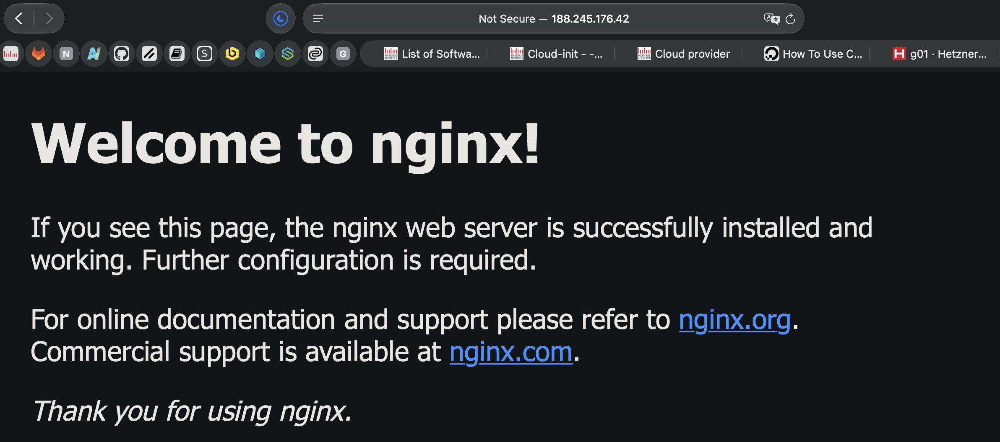
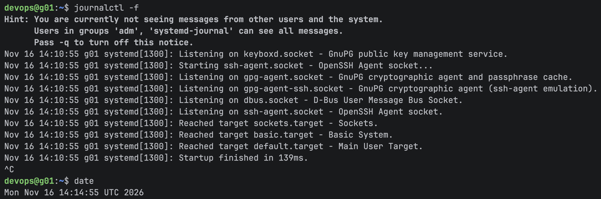
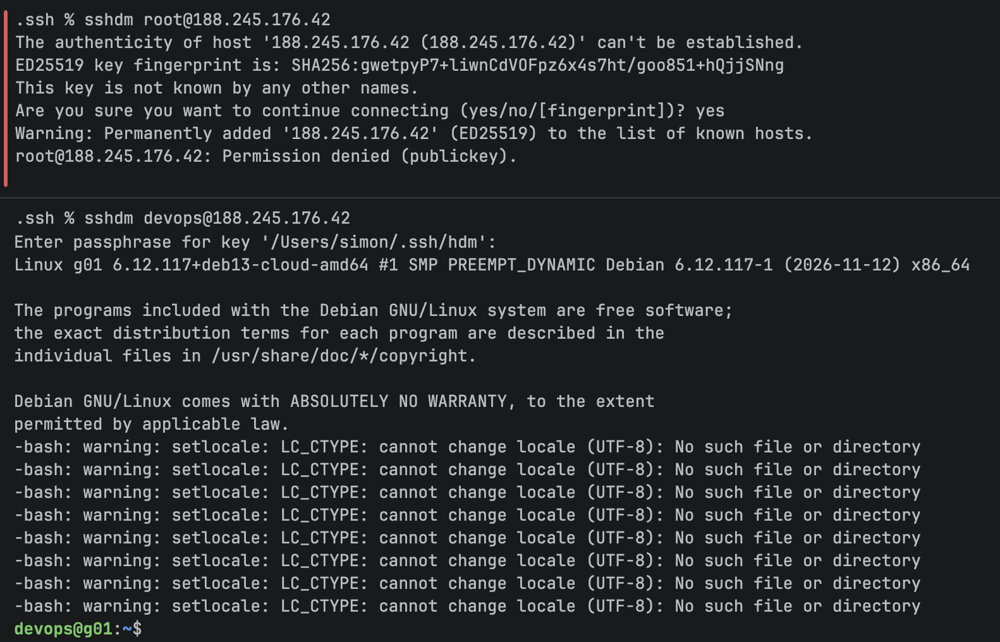
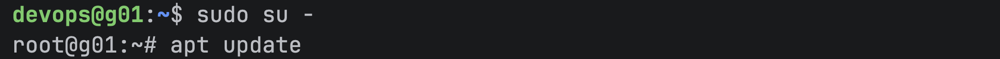
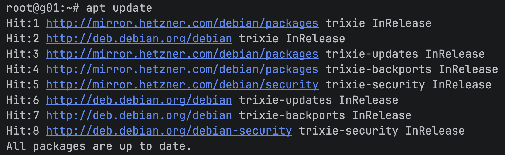
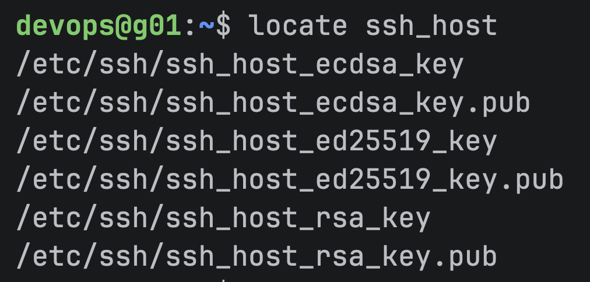
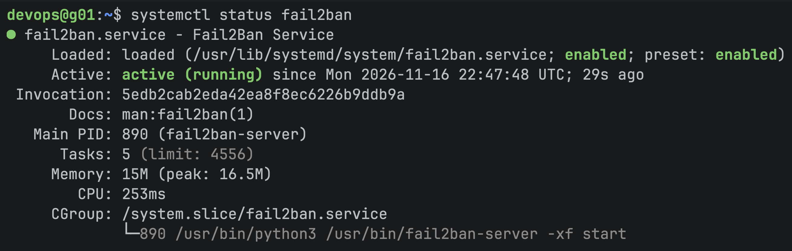

# Result

## Webserver
The webserver was inaccessible while the firewall didn't allow coonnections on port 80:

After adding the rule that allows HTTP packets, the standard _nginx_ landing page was being served correctly:

## Login attempts

Following the journal showed that no suspicious login attempts were happening during the approximate three minutes of observation:
Suspicous attempt were being blocked by the firewall and ssh configuration.

## Devops user
Logging in as `root` was prohibited. The only user that could log in via _SSH_ was the user `devops`:

The user `devops` created via _cloud-init_ had sudo privileges:

## Server upgrade
The directives added to _cloud-init_ updated all packages during initialization.
This can be confirmed by running `apt update` immediately after server creation has finished, confirming there are no outdated packages:

## Locate
Installing _plocate_ via _cloud-init_ was successful as well. 
The machine was indexed and searchable after startup:

## Fail2Ban
As was explained in [Ex. 19 - Fail2Ban](../19.%20Cloud-init%20for%20starters/2.%20Result.md#fail2ban), _fail2ban_ gets undermined by the sshd penalty system.
It was set up, but not functional.
The service was running on the machine, meaning it was set up by _cloud-init_:

