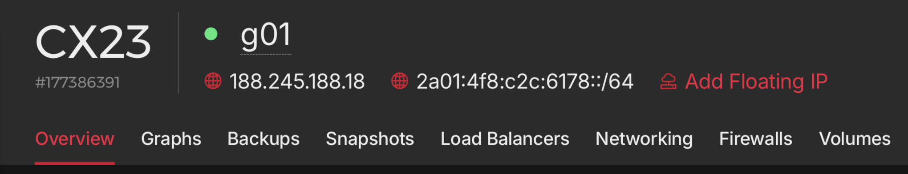
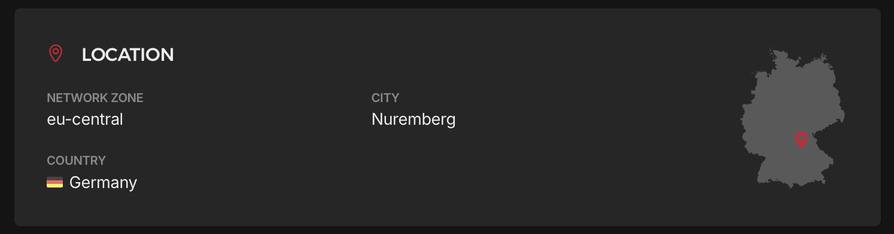

# Results

## Server
The server was created in the same manner as has been demonstrated in the previous exercises:


<br>


## Metadata File
The generated output at `gen/g01_metadata.json` inside the exercise directory matched the generated server's metadata:
```json
{
  "name": "g01",
  "network": {
    "ipv4": "188.245.188.18",
    "ipv6": "2a01:4f8:c2c:6178::1"
  },
  "location": "nbg1"
}
```