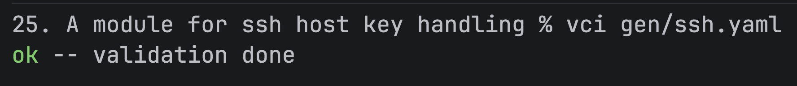
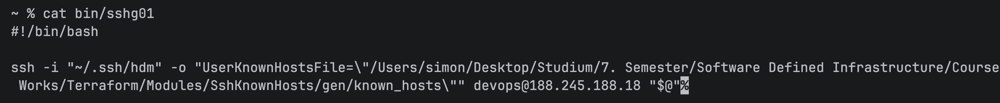
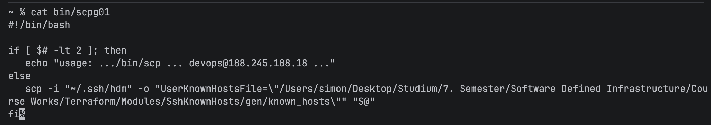
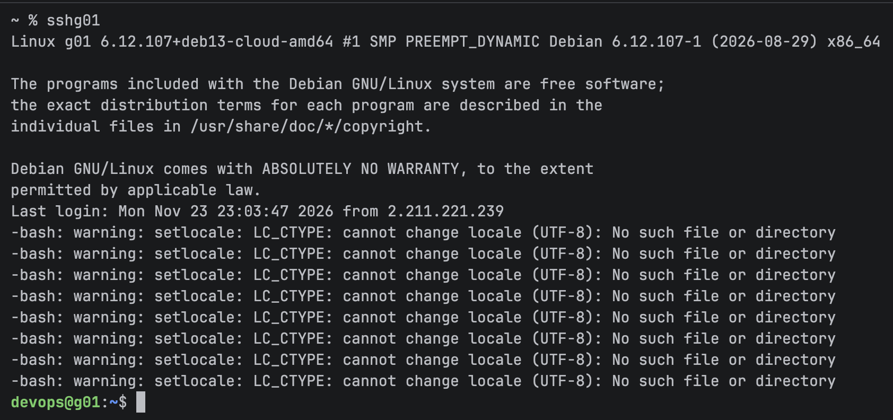
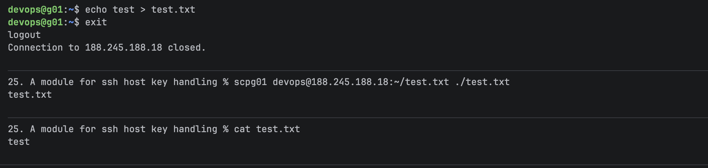

# Result

The results documented on this page are largely the same as they were
for [Ex. 23 - Solving the known host quirk](../23.%20Solving%20the%20known_hosts%20quirk/1.%20Solution.md#solution).
The major difference is that this solution was generated via another module.

## ssh.yaml

The _cloud-init_ configuration was generated at `gen/ssh.yaml` in the exact same as
in [Ex. 23 - Solving the known host quirk](../23.%20Solving%20the%20known_hosts%20quirk/1.%20Solution.md#user-data).
The generated configuration file was valid:



### known_hosts

The _known_hosts_ file was generated at `Modules/SshKnownHosts/gen/known_hosts`, containing the server's IP and public
key:

```
188.245.188.18 ssh-ed25519 AAAAC3NzaC1lZDI1NTE5AAAAINSIvStiEa8EakOPvS8j4oCq0y7Nc51dc16Y0qASZAyV
```

## SSH Wrappers

The SSH and SCP wrappers worked the exact same they did
in [Ex. 23 - Solving the known host quirk](../23.%20Solving%20the%20known_hosts%20quirk/1.%20Solution.md#ssh-wrappers).
They were created via the `SshKnownHosts` module and placed in the provided `bin` directory.

### Scripts






## Script verification


<br>

<br>
